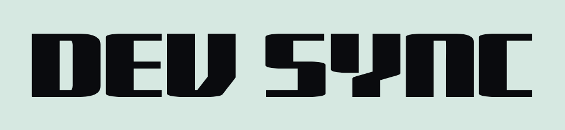
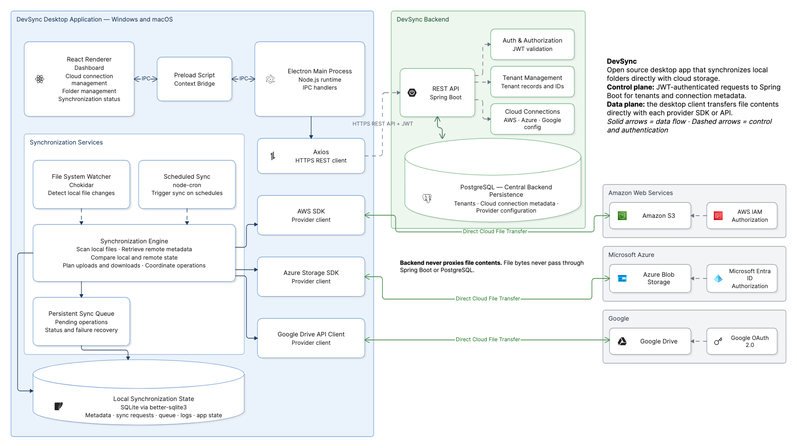

<div align="center">



**Open source desktop application for bi directional synchronization between local folders and cloud storage**

<br/>

[](https://www.electronjs.org)
[](https://react.dev)
[](https://spring.io/projects/spring-boot)
[](https://www.postgresql.org)
[](https://www.sqlite.org)
[](https://aws.amazon.com/s3)
[](https://www.google.com/drive)
[](https://azure.microsoft.com/products/storage/blobs)

</div>

---

## System Architecture

<div align="center">
  
</div>

The architecture separates the desktop application's **data plane** from the backend's **control plane**. The Electron client transfers file contents directly to cloud providers. The Spring Boot backend handles authenticated API requests, tenant management, and cloud connection metadata.

---

## Architecture Overview

### 1. Desktop Application

The Windows and macOS desktop client uses Electron with a React renderer.

| Component | Responsibility |
|---|---|
| React Renderer | Dashboard, cloud connection management, folder management, and synchronization status |
| Electron Main Process | Node.js runtime and IPC handlers |
| Preload Script | Context Bridge and controlled IPC communication between renderer and main process |
| Chokidar | Detects local file system changes |
| node-cron | Triggers scheduled synchronization |
| Synchronization Engine | Scans local files, retrieves remote metadata, compares states, and coordinates operations |
| Persistent Sync Queue | Tracks pending operations and operation status |
| Axios | Sends HTTPS REST requests to the backend |
| SQLite | Stores local synchronization state |
| better-sqlite3 | Node.js binding used to access SQLite |

### 2. Backend

The Spring Boot backend provides the control plane for the desktop application.

| Component | Responsibility |
|---|---|
| Spring Boot REST API | Handles requests from authenticated desktop clients |
| JWT Authentication and Authorization | Validates JWTs for protected API endpoints |
| Tenant Management | Manages tenant records and identifiers |
| Cloud Connection Management | Maintains tenant-specific cloud connection metadata |
| PostgreSQL | Stores tenant records, cloud connection metadata, and provider configuration |

### 3. Cloud Providers

The desktop client communicates directly with the supported provider APIs for file operations.

| Provider | Service | Authentication |
|---|---|---|
| Amazon Web Services | Amazon S3 | AWS IAM |
| Microsoft Azure | Azure Blob Storage | Microsoft Entra ID |
| Google | Google Drive | Google OAuth 2.0 |
| Dropbox | Not shown as an active integration in the current architecture | To be confirmed |

Authentication flows and credential storage should follow each provider's recommended security practices. The tenant ID identifies a tenant; it is not an authentication credential.

---

## Synchronization Flow

```text
Local File Change                         Scheduled Trigger
       │                                        │
       ▼                                        ▼
Chokidar File Watcher                     node-cron Scheduler
       │                                        │
       └───────────────────┬────────────────────┘
                           ▼
                 Synchronization Engine
                           │
                           ▼
                 Local / Remote Metadata
                      Comparison
                           │
                           ▼
                 Persistent Sync Queue
                           │
                           ▼
                  Provider Client SDK
                           │
               ┌───────────┼────────────┐
               ▼           ▼            ▼
          Amazon S3    Azure Blob   Google Drive
```

The synchronization engine coordinates file operations. The persistent queue tracks pending operations and their status. Exact retry, conflict-resolution, and deletion-propagation behavior depends on the implementation.

---

## Request and Authentication Flow

```text
DevSync Desktop
      │
      │ HTTPS REST API + JWT
      ▼
Spring Boot REST API
      │
      ├── Authentication and Authorization
      │
      ├── Tenant Management
      │
      └── Cloud Connection Management
                   │
                   ▼
               PostgreSQL
```

The backend manages tenant and connection metadata. The desktop client uses the appropriate provider SDK or API to transfer file contents directly to the cloud provider; file bytes do not pass through Spring Boot or PostgreSQL.

### Provider Authentication

- **Amazon S3:** AWS IAM-based authorization.
- **Azure Blob Storage:** Microsoft Entra ID-based authorization.
- **Google Drive:** Google OAuth 2.0.

The exact credential acquisition and secure storage implementation should be documented according to the current codebase.

---

## Data Persistence

| Database | Location | Purpose |
|---|---|---|
| SQLite | Local desktop application | Local metadata, synchronization requests, queue entries, activity logs, and application state |
| PostgreSQL | Backend | Tenant records and cloud connection metadata |

SQLite and PostgreSQL serve separate purposes; they are not a distributed database cluster. Synchronized file contents remain in the configured cloud storage provider.

---

## Technology Stack

| Layer | Technology |
|---|---|
| Desktop runtime | Electron |
| Frontend | React |
| Main process | Node.js |
| Renderer-to-main communication | Preload, Context Bridge, IPC |
| Filesystem monitoring | Chokidar |
| Scheduled tasks | node-cron |
| HTTP client | Axios |
| Local database | SQLite |
| SQLite driver | better-sqlite3 |
| Backend | Spring Boot |
| Backend API authentication | JWT |
| Backend database | PostgreSQL |
| AWS storage | Amazon S3, AWS SDK, IAM |
| Azure storage | Azure Blob Storage, Microsoft Entra ID |
| Google storage | Google Drive API, Google OAuth 2.0 |

---

## Security Boundaries

- The desktop client authenticates to protected backend endpoints using JWT.
- Tenant identifiers are not authentication credentials.
- Cloud provider authorization is separate from DevSync backend authentication.
- Provider credentials and OAuth tokens should be stored and handled securely.
- File contents transfer directly between the desktop client and cloud providers.
- PostgreSQL stores backend metadata, while SQLite stores client-local synchronization state.

---

## Project Status

The diagram documents the intended component boundaries and data flows. Confirm each feature against the current implementation before treating it as production-ready.

| Area | Status |
|---|---|
| Electron desktop application | Existing application |
| React interface | Existing frontend |
| Spring Boot backend | Existing backend |
| PostgreSQL tenant and connection metadata | As specified |
| SQLite local synchronization state | As specified |
| Direct cloud file transfer | As specified |
| Amazon S3 with IAM | As specified |
| Azure Blob Storage with Microsoft Entra ID | As specified |
| Google Drive with Google OAuth 2.0 | As specified |
| Dropbox integration | To be confirmed |

---

<div align="center">

**DevSync** · Open source · Built for developers

</div>
